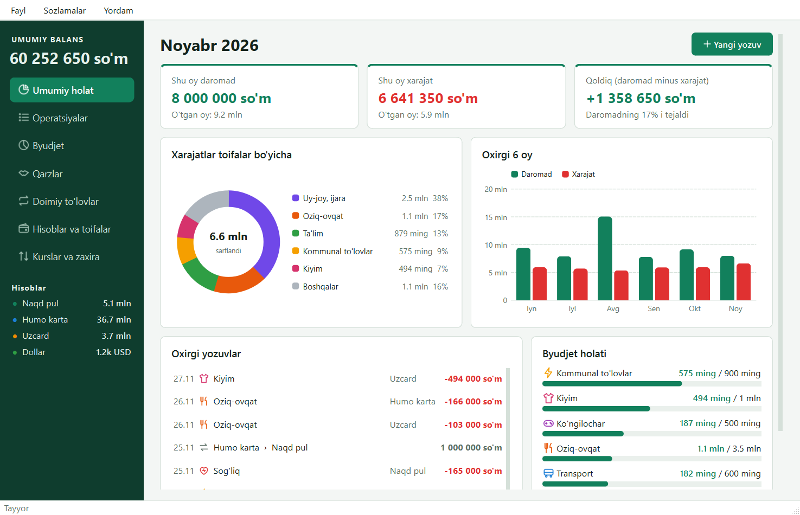
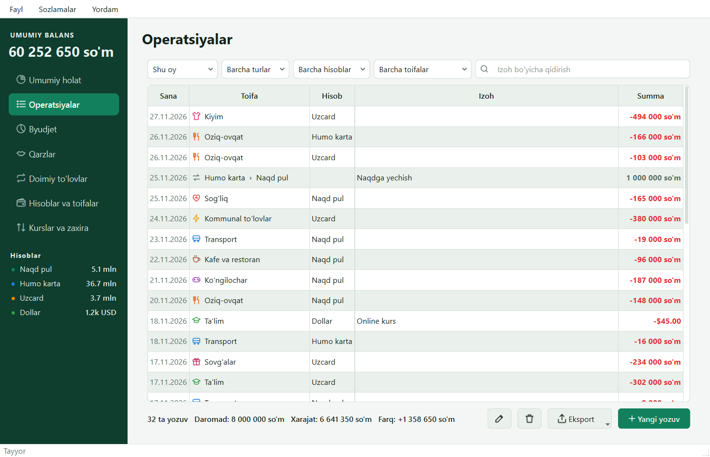
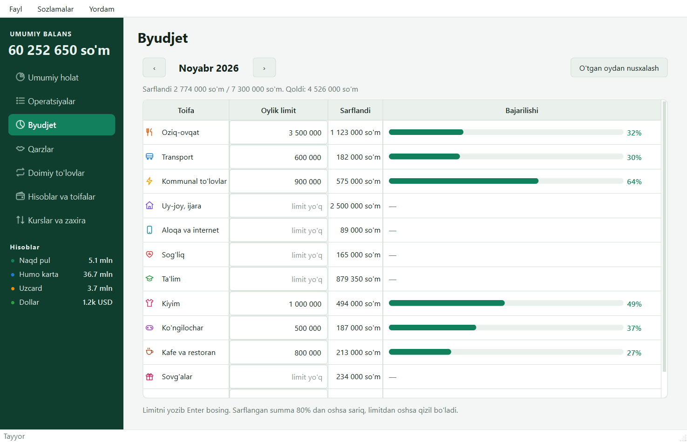
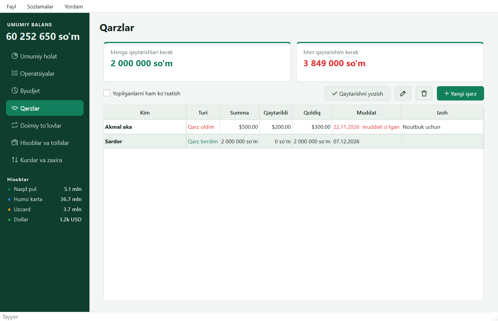
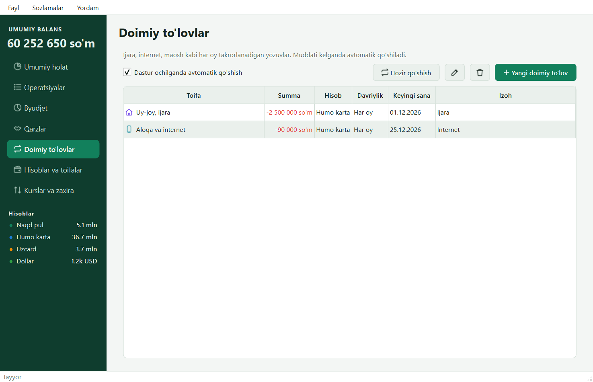
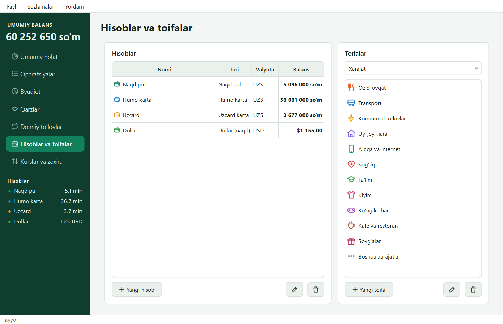
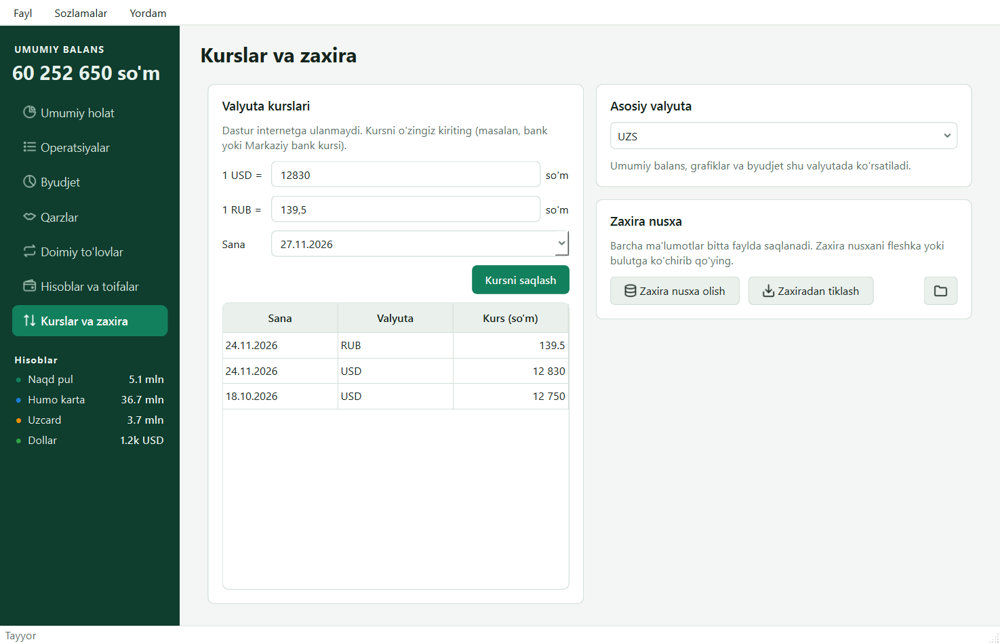
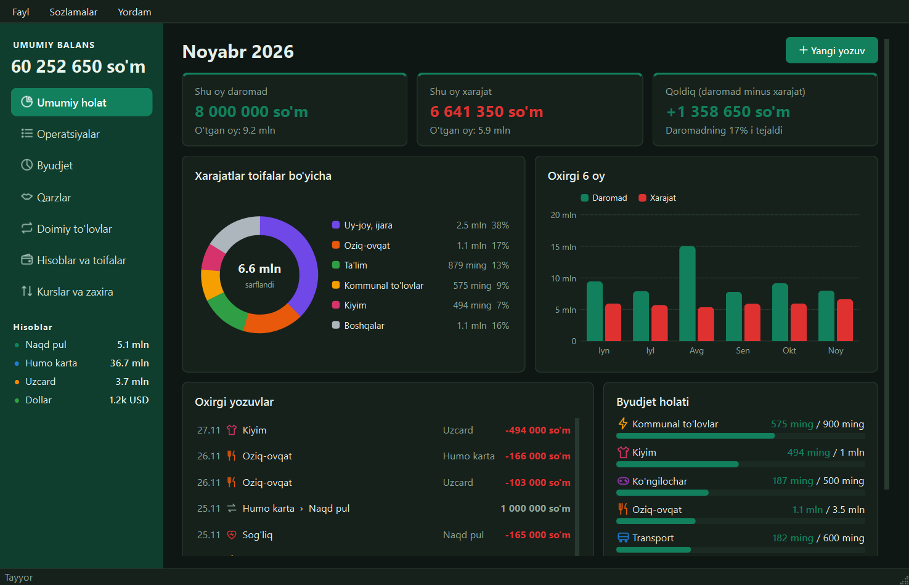

<h1 align="center">Shaxsiy xarajatlar hisobchisi</h1>

<b>Personal Expense Tracker</b> · Учёт личных расходов

   
  
  
  
  

Shaxsiy moliya dasturi: naqd pul, Humo, Uzcard va dollar hisoblari, daromad va xarajatlar toifalar bo'yicha, so'm, dollar va rublda qo'lda kiritiladigan kurs bilan, oylik byudjet, qarzlar, doimiy to'lovlar, grafiklar, Excel/CSV eksport va zaxira nusxa. Internetsiz ishlaydi.

## Imkoniyatlar

- Hisoblar: naqd, Humo, Uzcard, Visa, dollar, omonat; har birining balansi
- Tezkor kiritish oynasi (Ctrl+N): summa, toifa belgilari, Enter bilan saqlash
- UZS / USD / RUB, kurs qo'lda kiritiladi, hisoblar orasida o'tkazma
- Toifalar o'z rangi va belgisi bilan, tahrirlanadi
- Oylik byudjet: progress chiziqlari, o'tgan oydan nusxalash
- Umumiy holat: oy daromad/xarajati, toifalar diagrammasi, 6 oylik grafik
- Qarzlar (berdim/oldim), qisman qaytarishlar; doimiy to'lovlar
- Qidiruv va filtrlar, Excel va CSV eksport, zaxira nusxa va tiklash

## O'rnatish

1. [**XarajatlarHisobchisi.exe**](https://github.com/eduhakimov/xarajatlar-hisobchisi/releases/latest/download/XarajatlarHisobchisi.exe) faylini yuklab oling.
2. Faylni ishga tushiring, o'rnatish shart emas.
3. Windows SmartScreen ogohlantirsa: **Batafsil → Baribir ishga tushirish**.

**Tizim talablari:** Windows 10 (1809+) / Windows 11, x64

---

## Русский

Программа учёта личных финансов: наличные, карты Humo и Uzcard, доллары; доходы и расходы по категориям в сумах, долларах и рублях с курсом, введённым вручную; месячный бюджет, долги, регулярные платежи, графики, экспорт в Excel/CSV и резервная копия. Работает без интернета.

- Счета: наличные, Humo, Uzcard, Visa, доллары, вклад; баланс каждого
- Быстрый ввод (Ctrl+N): сумма, значки категорий, сохранение по Enter
- UZS / USD / RUB, курс вводится вручную, переводы между счетами
- Категории со своим цветом и значком, редактируются
- Месячный бюджет с индикаторами, копирование с прошлого месяца
- Обзор: доход и расход за месяц, диаграмма категорий, график за 6 месяцев
- Долги (дал/взял), частичные возвраты; регулярные платежи
- Поиск и фильтры, экспорт в Excel и CSV, резервная копия и восстановление

## English

Personal finance tracker: cash, Humo and Uzcard cards, US dollars; income and spending by category in UZS, USD and RUB with manually entered rates; monthly budgets, debts, recurring payments, charts, Excel/CSV export and backups. Works offline.

- Accounts: cash, Humo, Uzcard, Visa, dollars, deposit; balance for each
- Quick entry (Ctrl+N): amount, category icons, Enter to save
- UZS / USD / RUB with manual rates, transfers between accounts
- Editable categories with their own colour and icon
- Monthly budgets with progress bars, copy from last month
- Overview: month income and spending, category donut, 6-month chart
- Debts (lent/borrowed) with partial repayments; recurring payments
- Search and filters, Excel and CSV export, backup and restore

---

## Muallif / Author

**Bahtiyorjon Hakimov** (Hakimov Bahtiyorjon Muzaffar o'g'li), [github.com/eduhakimov](https://github.com/eduhakimov)

© 2026 Bahtiyorjon Hakimov. Barcha huquqlar himoyalangan. / Все права защищены. / All rights reserved.
Batafsil: [LICENSE](LICENSE) · Uchinchi tomon komponentlari: [THIRD_PARTY_NOTICES.md](THIRD_PARTY_NOTICES.md)
