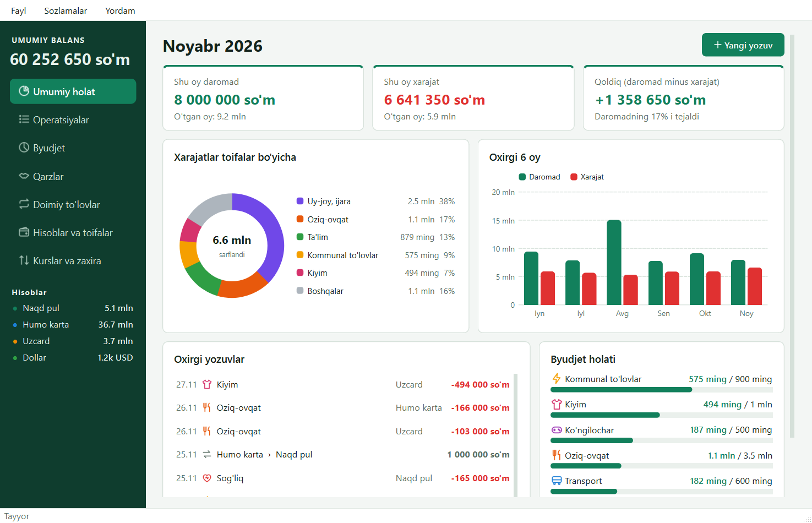
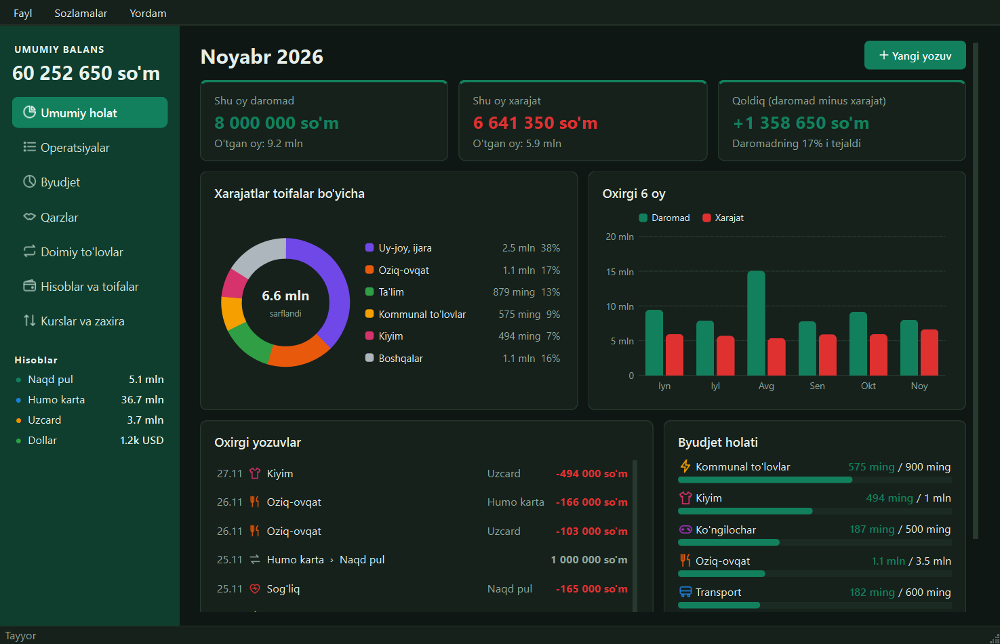
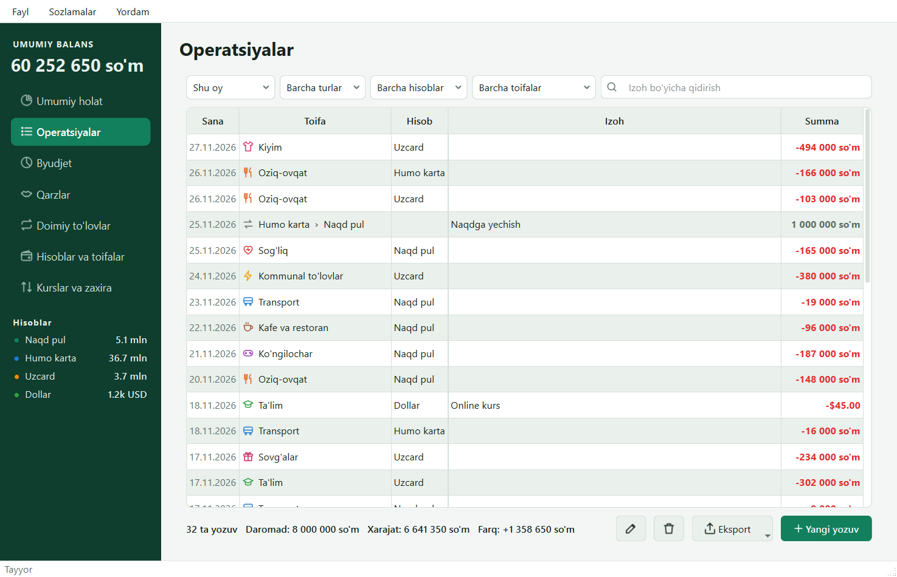
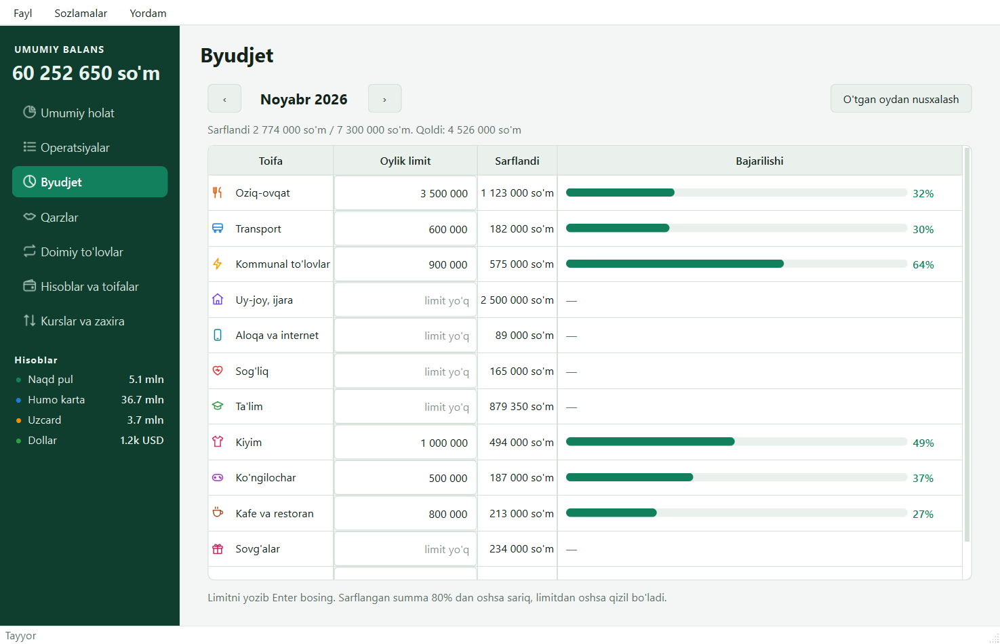
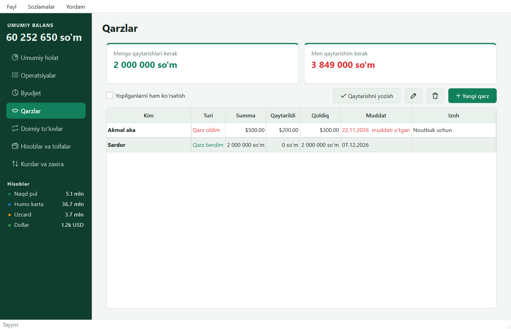
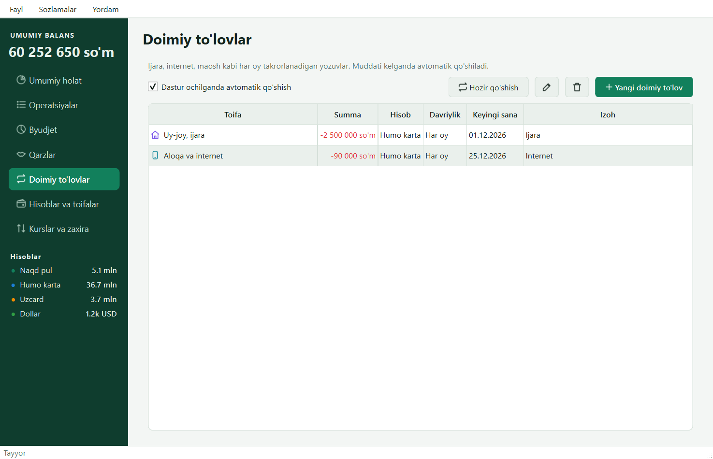
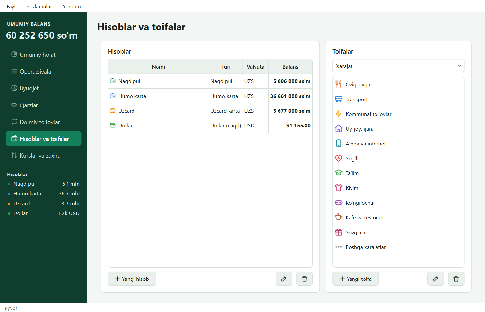
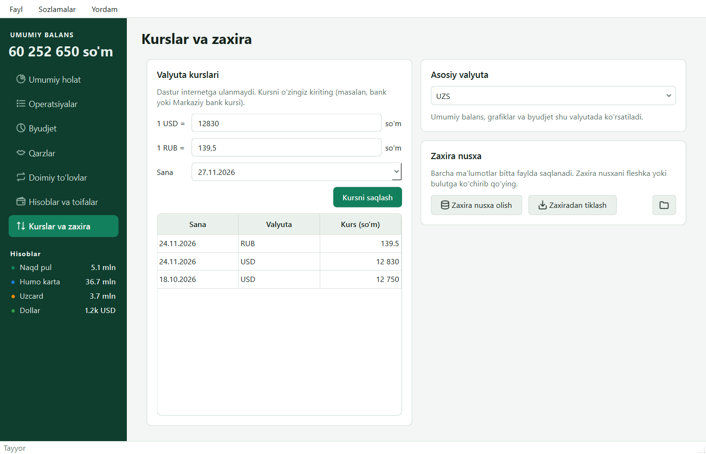

# Xarajatlar hisobchisi: Foydalanish qo‘llanmasi

Muallif: Hakimov Bahtiyorjon. Versiya: 1.0.2.

## 1. Umumiy ma’lumot

“Xarajatlar hisobchisi” shaxsiy va oilaviy pul mablag‘larini hisobga olish dasturi. U qayerda qancha pulingiz borligini, oy davomida qancha topib, qancha sarflaganingizni, pul qaysi toifalarga ketayotganini, byudjet limitlari bajarilishini, kim sizdan qarzdor va siz kimdan qarzdor ekaningizni ko‘rsatadi.

Dastur yordamida quyidagi ishlar bajariladi:

- naqd pul, Humo, Uzcard, Visa / Mastercard, dollar va omonat hisoblarini yuritish;
- daromad, xarajat va hisoblar orasidagi o‘tkazmalarni toifalar bo‘yicha kiritish;
- so‘m, dollar va rubldagi hisoblarni qo‘lda kiritiladigan kurs bilan bitta valyutada umumlashtirish;
- toifalar uchun oylik byudjet belgilash va uning bajarilishini kuzatish;
- berilgan va olingan qarzlarni qisman qaytarishlar bilan yuritish;
- ijara, internet, maosh kabi doimiy to‘lovlarni avtomatik qo‘shish;
- diagramma va grafiklarda tahlil qilish, Excel va CSV ga eksport qilish, zaxira nusxa olish.
Dastur talabalar, oila byudjetini yurituvchilar, mustaqil ishlovchilar va o‘z xarajatlarini tartibga solmoqchi bo‘lgan har qanday foydalanuvchi uchun mo‘ljallangan. Interfeys o‘zbek, rus va ingliz tillarida, yorug‘ va qorong‘i mavzularda ishlaydi. Dastur hisob yuritish vositasi bo‘lib, moliyaviy maslahat bermaydi.

## 2. Tizim talablari

- Operatsion tizim: Windows 10 (1809 va undan keyingi versiyalar) yoki Windows 11, 64 bitli.
- Internet aloqasi talab qilinmaydi. Valyuta kurslari ham internetdan olinmaydi, ularni o‘zingiz kiritasiz.
- O‘rnatish shart emas: dastur bitta bajariladigan fayldan iborat.
- Excel faylini ko‘rish uchun xlsx formatini ochadigan dastur kerak bo‘ladi.
Dastur ishlashi uchun bank ilovasi, internet-banking yoki qo‘shimcha dasturlar talab etilmaydi: barcha yozuvlar qo‘lda kiritiladi.

## 3. O‘rnatish va ishga tushirish

1. Dasturning GitHub sahifasidagi (https://github.com/eduhakimov/xarajatlar-hisobchisi) Releases bo‘limidan bajariladigan faylni yuklab oling.
2. Faylni qulay papkaga joylashtiring va ikki marta bosib ishga tushiring.
3. Birinchi ishga tushirishda Windows SmartScreen “Windows kompyuteringizni himoya qildi” ogohlantirishini ko‘rsatishi mumkin. Bu imzolanmagan dasturlar uchun odatiy holat: “Batafsil” havolasini, so‘ng “Baribir ishga tushirish” tugmasini bosing.
4. Birinchi ishga tushirishda dastur standart toifalarni (oziq-ovqat, transport, kommunal to‘lovlar, maosh, stipendiya va boshqalar) hamda “Naqd pul” va “Humo karta” hisoblarini nol qoldiq bilan avtomatik yaratadi.
5. “Hisoblar va toifalar” sahifasida hisoblaringizni tekshiring: kerak bo‘lsa yangi hisob qo‘shing va har biriga hozirgi qoldiqni “Boshlang‘ich qoldiq” sifatida kiriting.
6. Dollar yoki rubl hisobingiz bo‘lsa, “Kurslar va zaxira” sahifasida kursni kiriting.
Dasturni yangilash uchun yangi versiyani yuklab olib, eski faylni almashtiring. Ma’lumotlar foydalanuvchi profilida saqlangani sababli yangilashda yo‘qolmaydi.

## 4. Dastur oynasi bilan tanishish

Oynaning yuqorisida menyu satri (“Fayl”, “Sozlamalar”, “Yordam”) joylashgan. Chapdagi to‘q yashil panelda “UMUMIY BALANS”, sahifalar ro‘yxati va pastda “Hisoblar” bo‘limi har bir hisobning balansi bilan ko‘rsatiladi. Sahifalar:

- **Umumiy holat** – oy natijalari, diagrammalar, oxirgi yozuvlar va byudjet holati;
- **Operatsiyalar** – barcha yozuvlar ro‘yxati, filtrlar va eksport;
- **Byudjet** – toifalar bo‘yicha oylik limitlar;
- **Qarzlar** – berilgan va olingan qarzlar;
- **Doimiy to‘lovlar** – takrorlanadigan yozuvlar;
- **Hisoblar va toifalar** – hisoblar va toifalarni boshqarish;
- **Kurslar va zaxira** – valyuta kurslari, asosiy valyuta va zaxira nusxa.
Pastdagi holat satrida saqlash va boshqa amallar natijasi haqida xabarlar chiqadi.

Yon paneldagi “Hisoblar” ro‘yxatida har bir hisob rangli nuqta va qisqa balans bilan ko‘rsatiladi (masalan, “5.1 mln” yoki dollar hisobi uchun “1.2k USD”). Arxivlangan hisoblar bu ro‘yxatda ko‘rinmaydi. “Umumiy holat” sahifasidagi “Yangi yozuv” tugmasi va Ctrl+N tugmalari bir xil oynani ochadi.

*1-rasm. “Umumiy holat” sahifasi: chapda umumiy balans va hisoblar, o‘ngda oylik ko‘rsatkichlar, diagrammalar, oxirgi yozuvlar va byudjet holati*

*2-rasm. Qorong‘i mavzudagi “Umumiy holat” sahifasi*

## 5. Asosiy amallar

**Yozuv qo‘shish**

1. Ctrl+N tugmalarini yoki “Yangi yozuv” tugmasini bosing.
2. Turini tanlang: “Xarajat”, “Daromad” yoki “O‘tkazma”.
3. Summani kiriting, masalan “125 000”. Kasr qismini vergul yoki nuqta bilan yozish mumkin.
4. Hisobni va toifa belgisini tanlang, kerak bo‘lsa sana va izohni kiriting (masalan, “Korzinka, bozor”).
5. Enter bosing – yozuv saqlanadi. Ketma-ket bir nechta yozuv kiritish uchun Ctrl+Enter bosing: yozuv saqlanadi va oyna keyingi yozuv uchun ochiq qoladi.
**Hisoblar orasida o‘tkazma**

1. “Yangi yozuv” oynasida “O‘tkazma” turini tanlang.
2. Qaysi hisobdan va “Qaysi hisobga” o‘tkazilishini tanlang.
3. Valyutalar farq qilsa, “Tushadigan summa” maydoniga haqiqatda tushgan summani yozing yoki bo‘sh qoldiring: u kurs bo‘yicha hisoblanadi. Kurs kiritilmagan bo‘lsa, dastur bu haqda xabar beradi.
O‘tkazmalar daromad va xarajat yig‘indisiga kirmaydi, faqat hisoblar balansini o‘zgartiradi.

**Operatsiyalarni ko‘rish va tahrirlash**

1. “Operatsiyalar” sahifasini oching.
2. Davr (“Shu oy”, “O‘tgan oy”, “Oxirgi 30 kun”, “Shu yil”, “Barcha vaqt”, “Oraliq...”), tur, hisob va toifa filtrlarini tanlang yoki “Izoh bo‘yicha qidirish” maydoniga so‘z yozing.
3. Yozuvni tahrirlash uchun uni ikki marta bosing yoki F2 tugmasini bosing.
4. O‘chirish uchun yozuv(lar)ni tanlab Delete tugmasini bosing va tasdiqlang.
5. Jadval ostida yozuvlar soni, daromad, xarajat va farq ko‘rsatiladi.
6. Takrorlanadigan xarid (masalan, har kungi yo‘l haqi) uchun yozuvni sichqonchaning o‘ng tugmasi bilan bosib, “Bugungi sana bilan nusxalash” bandini tanlang: yozuv bugungi sana bilan nusxalanadi.
**Eksport**

“Operatsiyalar” sahifasidagi “Eksport” tugmasini bosib, “Excel (.xlsx)” yoki “CSV” ni tanlang. Joriy filtr bo‘yicha ko‘rinib turgan yozuvlar saqlanadi.

**Byudjet belgilash**

1. “Byudjet” sahifasini oching va kerakli oyni tanlang.
2. Toifa qatoridagi “Oylik limit” maydoniga summani yozing va Enter bosing.
3. Bajarilish chizig‘i 80 foizdan oshganda sariq, limitdan oshganda qizil rangga kiradi.
4. Yangi oyda limitlarni qayta yozmaslik uchun “O‘tgan oydan nusxalash” tugmasini bosing.
**Qarzlarni yuritish**

1. “Qarzlar” sahifasida “Yangi qarz” tugmasini bosing.
2. Turini (“Qarz berdim” yoki “Qarz oldim”), ismni, summani, valyutani, sanani, kerak bo‘lsa muddat va izohni kiriting.
3. Qarzning bir qismi qaytarilganda uni tanlab “Qaytarishni yozish” tugmasini bosing va summani kiriting.
4. Qarz to‘liq qaytarilganda avtomatik yopiladi. Yopilgan qarzlarni ko‘rish uchun “Yopilganlarni ham ko‘rsatish” belgisini yoqing.
**Doimiy to‘lovlar**

1. “Doimiy to‘lovlar” sahifasida “Yangi doimiy to‘lov” tugmasini bosing.
2. Turini, hisobni, toifani, summani, izohni (masalan, “Ijara”), davriylikni (“Har oy”, “Har hafta”, “Har yil”) va keyingi sanani kiriting.
3. “Dastur ochilganda avtomatik qo‘shish” belgisi yoqilgan bo‘lsa, muddati kelgan yozuvlar dastur ishga tushganda qo‘shiladi. Belgi o‘chirilgan bo‘lsa, dastur qo‘shishni so‘raydi. Qo‘lda qo‘shish uchun “Hozir qo‘shish” tugmasini bosing.
**Hisob va toifa qo‘shish**

“Hisoblar va toifalar” sahifasida “Yangi hisob” yoki “Yangi toifa” tugmasini bosing. Hisob uchun nom, tur, valyuta, boshlang‘ich qoldiq va rang, toifa uchun nom, rang va belgi tanlanadi. Yozuvlari bor hisobni o‘chirish o‘rniga uni “Arxivlangan” deb belgilang.

*3-rasm. “Operatsiyalar” sahifasi: filtrlar, yozuvlar jadvali, pastda “Eksport” va “Yangi yozuv” tugmalari*

*4-rasm. “Byudjet” sahifasi: oylik limitlar va bajarilish chiziqlari*

*5-rasm. “Qarzlar” sahifasi: “Menga qaytarishlari kerak” va “Men qaytarishim kerak” kartalari, qarzlar jadvali, muddati o‘tgan qarz qizil rangda*

*6-rasm. “Doimiy to‘lovlar” sahifasi: “Dastur ochilganda avtomatik qo‘shish” belgisi va ijara hamda internet to‘lovlari*

*7-rasm. “Hisoblar va toifalar” sahifasi: hisoblar jadvali va xarajat toifalari ro‘yxati*

## 6. Sozlamalar

- **Valyuta kurslari:** “Kurslar va zaxira” sahifasida 1 USD va 1 RUB necha so‘m ekanini va sanani kiriting, so‘ng “Kursni saqlash” tugmasini bosing. Kurslar tarixi jadvalda saqlanadi, hisob-kitoblarda eng so‘nggi kurs qo‘llanadi.
- **Asosiy valyuta:** shu sahifadagi “Asosiy valyuta” ro‘yxatidan UZS, USD yoki RUB ni tanlang. Umumiy balans, grafiklar va byudjet shu valyutada ko‘rsatiladi.
- **Til:** “Sozlamalar” → “Til” menyusidan O‘zbekcha, Русский yoki English ni tanlang; dastur qayta ishga tushiriladi.
- **Mavzu:** “Sozlamalar” → “Mavzu” menyusidan “Yorug‘”, “Qorong‘i” yoki “Tizim bo‘yicha” ni tanlang.
- **Doimiy to‘lovlarni avtomatik qo‘shish:** “Doimiy to‘lovlar” sahifasidagi belgi orqali yoqiladi yoki o‘chiriladi.
Dasturda alohida sozlamalar oynasi yo‘q: kurslar, asosiy valyuta va zaxira nusxa “Kurslar va zaxira” sahifasida, til va mavzu esa menyu orqali boshqariladi. O‘zgartirilgan sozlamalar avtomatik saqlanadi va keyingi ishga tushirishda tiklanadi.

*8-rasm. “Kurslar va zaxira” sahifasi: valyuta kurslari, asosiy valyuta va zaxira nusxa tugmalari*

## 7. Ma’lumotlarni saqlash va xavfsizlik

- Barcha ma’lumotlar %APPDATA%\BahtiyorSoft\xarajatlar-hisobchisi papkasidagi “xarajatlar.db” faylida saqlanadi. “Kurslar va zaxira” sahifasidagi papka tugmasi shu papkani ochadi.
- Dastur internetga ulanmaydi va ma’lumotlaringizni hech qayerga yubormaydi.
- **Zaxira nusxa olish:** “Zaxira nusxa olish” tugmasini bosing va faylni saqlash joyini tanlang. Nusxani fleshka yoki boshqa diskka ko‘chirib qo‘yish tavsiya etiladi.
- **Zaxiradan tiklash:** “Zaxiradan tiklash” tugmasini bosib, zaxira faylini tanlang. Dastur faylni tekshiradi: u dastur zaxira nusxasi bo‘lmasa yoki shikastlangan bo‘lsa, tiklash bajarilmaydi. Tiklashdan oldin joriy ma’lumotlarning nusxasi avtomatik saqlanadi va uning joylashuvi ko‘rsatiladi.
- Baza fayli shifrlanmaydi. Kompyuteringizdan boshqalar ham foydalansa, Windows hisobingizga parol qo‘ying.
- Hisob yoki toifani o‘chirishda dastur ma’lumot yo‘qolishining oldini oladi: yozuvlari bor hisobni arxivlash taklif etiladi, toifa yozuvlari esa boshqa toifaga o‘tkaziladi.

## 8. Ko‘p uchraydigan savollar va muammolar

**“Summani to‘g‘ri kiriting” xabari chiqdi.** Summani raqamlar bilan yozing, masalan “125 000” yoki “12,50”. Harflar va boshqa belgilar qabul qilinmaydi.

**“Valyuta kursi kiritilmagan” xabari chiqdi.** “Kurslar va zaxira” sahifasida tegishli valyuta kursini kiriting yoki o‘tkazmada tushadigan summani qo‘lda yozing.

**Dollar hisobim umumiy balansga qo‘shilmayapti.** Dollar kursi kiritilmagan bo‘lishi mumkin. Kursni kiriting, shundan so‘ng umumiy balans qayta hisoblanadi.

**Hisobni o‘chira olmayapman.** Hisobda yozuvlar bo‘lsa, uni o‘chirib bo‘lmaydi. Hisobni tahrirlab, “Arxivlangan” belgisini yoqing: u ro‘yxatlarda ko‘rinmaydi, lekin tarix saqlanadi.

**Oxirgi toifani o‘chirib bo‘lmayapti.** Har bir turda (daromad va xarajat) kamida bitta toifa bo‘lishi kerak.

**Doimiy to‘lov ikki marta qo‘shildimi?** Har bir doimiy to‘lov qo‘shilgach, uning keyingi sanasi avtomatik suriladi, shuning uchun bir sana uchun yozuv bir marta yaratiladi.

**Excel faylini saqlab bo‘lmadi.** Fayl boshqa dasturda ochiq bo‘lishi mumkin. Uni yoping va qayta urinib ko‘ring.

**SmartScreen dasturni ishga tushirishga ruxsat bermayapti.** “Batafsil” havolasini, so‘ng “Baribir ishga tushirish” tugmasini bosing. Faylni faqat rasmiy GitHub sahifasidan yuklab oling.

**Ma’lumotlarni boshqa kompyuterga qanday ko‘chiraman?** Eski kompyuterda “Zaxira nusxa olish” orqali fayl yarating, uni yangi kompyuterga ko‘chiring va u yerda “Zaxiradan tiklash” tugmasi orqali tanlang.

**Kursni noto‘g‘ri kiritib qo‘ydim.** To‘g‘ri kursni o‘sha sana bilan qayta kiriting: bir sana va valyuta uchun eski qiymat yangisi bilan almashtiriladi. Kurslar tarixi jadvalidan noto‘g‘ri yozuvni o‘chirish ham mumkin.

**Dastur kutilmagan xato haqida xabar berdi.** Xato tafsilotlari ma’lumotlar papkasidagi jurnal fayliga yoziladi. Muammo takrorlansa, shu faylni GitHub sahifasi orqali muallifga yuboring.

