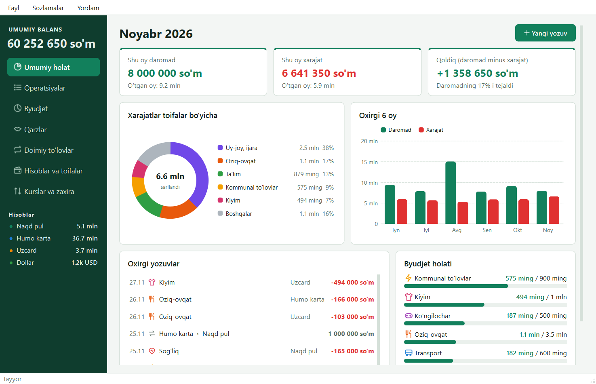
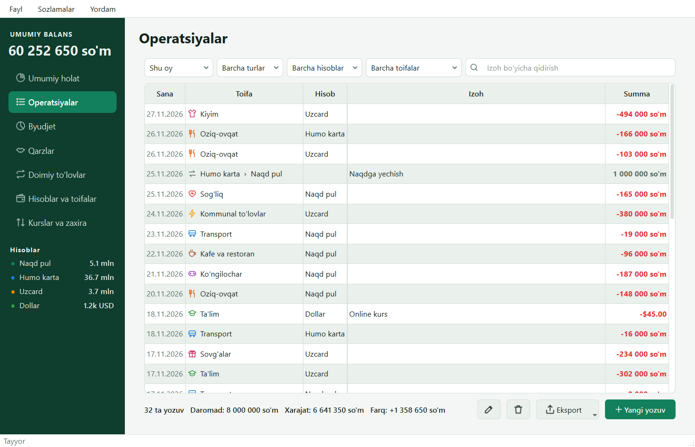
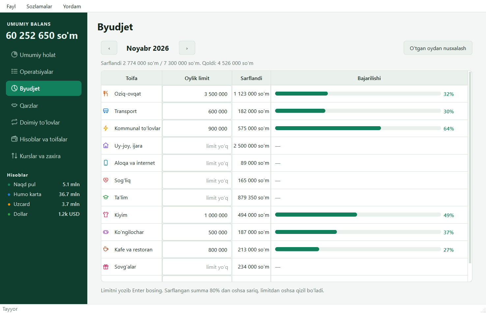
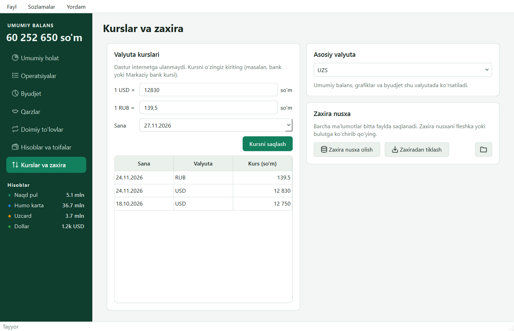

UDK: 004.42:330.567

# Shaxsiy moliyaviy hisobni ko‘p valyutali yuritish uchun oflayn dasturiy vosita: ma’lumotlar modeli, hisob-kitob algoritmlari va amalga oshirish

**Hakimov Bahtiyorjon**  
*[ish joyi, lavozimi, elektron pochta]*

**Annotatsiya.** Maqolada shaxsiy daromad va xarajatlarni hisobga oluvchi “Xarajatlar hisobchisi” stol dasturi tavsiflanadi. Dastur naqd pul, Humo, Uzcard, Visa, dollar va omonat hisoblarini, toifalar bo‘yicha daromad va xarajatlarni, hisoblar orasidagi o‘tkazmalarni, oylik byudjetni, qarzlarni va doimiy to‘lovlarni yagona SQLite bazasida yuritadi. Summalar butun minor birliklarda saqlanadi, so‘m, dollar va rubl o‘rtasidagi hisob-kitoblar foydalanuvchi qo‘lda kiritgan kurs asosida o‘nlik arifmetika bilan bajariladi. Umumiy holat sahifasida toifalar diagrammasi va olti oylik grafik ko‘rsatiladi, ma’lumotlar Excel va CSV formatlariga eksport qilinadi, zaxira nusxa tekshiruv bilan tiklanadi. Dastur Python 3.12 va PySide6 asosida yaratilgan va internetsiz ishlaydi.

*Kalit so‘zlar:* shaxsiy moliya, xarajatlar hisobi, oylik byudjet, valyuta kursi, SQLite, PySide6, oflayn dastur.

**Офлайн-программное средство для мультивалютного учёта личных финансов: модель данных, алгоритмы расчётов и реализация**

**Аннотация.** В статье описывается настольная программа «Xarajatlar hisobchisi» для учёта личных доходов и расходов. Программа ведёт в единой базе SQLite счета (наличные, Humo, Uzcard, Visa, доллары, вклад), доходы и расходы по категориям, переводы между счетами, месячный бюджет, долги и регулярные платежи. Суммы хранятся в целых минорных единицах, расчёты между сумом, долларом и рублём выполняются с десятичной арифметикой по курсу, который пользователь вводит вручную. На странице обзора показываются диаграмма категорий и график за шесть месяцев, данные экспортируются в Excel и CSV, резервная копия восстанавливается с проверкой. Программа создана на Python 3.12 и PySide6 и работает без интернета.

*Ключевые слова:* личные финансы, учёт расходов, месячный бюджет, валютный курс, SQLite, PySide6, офлайн-программа.

**An Offline Software Tool for Multi-Currency Personal Finance Tracking: Data Model, Calculation Algorithms and Implementation**

**Abstract.** The paper describes “Xarajatlar hisobchisi”, a desktop program for tracking personal income and expenses. In a single SQLite database it keeps accounts (cash, Humo, Uzcard, Visa, US dollars, savings), income and expenses by category, transfers between accounts, a monthly budget, debts and recurring payments. Amounts are stored as integer minor units, and conversions between Uzbek sum, US dollar and Russian rouble use decimal arithmetic with exchange rates entered manually by the user. The overview page shows a category donut chart and a six-month bar chart, data can be exported to Excel and CSV, and a backup is restored only after verification. The program is built with Python 3.12 and PySide6 and works offline.

*Keywords:* personal finance, expense tracking, monthly budget, exchange rate, SQLite, PySide6, offline software.

## Kirish

Shaxsiy moliyaviy savodxonlik zamonaviy iqtisodiy muhitda har bir fuqaro uchun zarur ko‘nikmalardan biri hisoblanadi. Daromad va xarajatlarni muntazam hisobga olish oilaviy byudjetni rejalashtirish, ortiqcha sarf-xarajatlarni aniqlash, jamg‘arma shakllantirish va qarz majburiyatlarini nazorat qilish uchun asos bo‘ladi. O‘zbekistonda to‘lovlar bir vaqtning o‘zida naqd pul, Humo va Uzcard kartalari, xorijiy to‘lov tizimlari kartalari orqali amalga oshiriladi, ayrim mablag‘lar esa xorijiy valyutada saqlanadi. Bu holat hisobni yuritishni murakkablashtiradi: turli hisoblardagi qoldiqlarni bitta valyutada umumlashtirish va hisoblar orasidagi o‘tkazmalarni daromad yoki xarajat sifatida noto‘g‘ri hisoblamaslik talab etiladi.

“Raqamli O‘zbekiston – 2030” strategiyasida aholining raqamli ko‘nikmalarini oshirish va raqamli xizmatlardan foydalanishni kengaytirish vazifalari belgilangan. Shaxsiy moliyani raqamli vositalar yordamida yuritish ana shu ko‘nikmalarning amaliy ko‘rinishlaridan biridir. Ayni paytda moliyaviy ma’lumotlar o‘ta shaxsiy xarakterga ega, shuning uchun ularni foydalanuvchining o‘z kompyuterida, tashqi serverlarga uzatmasdan saqlash ko‘plab foydalanuvchilar uchun muhim talab hisoblanadi.

Mazkur maqolada ushbu talablarga javob beruvchi “Xarajatlar hisobchisi” dasturi taqdim etiladi. Dastur hisoblar, toifalar, operatsiyalar, valyuta kurslari, byudjet, qarzlar va doimiy to‘lovlarni yagona relyatsion bazada yuritadi, barcha hisob-kitoblarni mahalliy bajaradi va natijalarni diagrammalar hamda jadvallar ko‘rinishida taqdim etadi.

Tadqiqot obyekti sifatida shaxsiy daromad va xarajatlarni hisobga olish jarayoni, predmeti sifatida esa bu jarayonni avtomatlashtiruvchi dasturiy vositaning ma’lumotlar modeli, pul summalari va sanalar bilan ishlash algoritmlari hamda arxitekturasi olingan. Maqolada dasturning manba kodi, avtomatik testlari va foydalanuvchi interfeysi tahlil qilinadi. Shuni alohida ta’kidlash lozimki, dastur hisob yuritish vositasi bo‘lib, moliyaviy maslahat bermaydi.

## Muammoning qo‘yilishi va mavjud yechimlar tahlili

Masalani quyidagicha ifodalash mumkin. Foydalanuvchi bir nechta hisobga ega bo‘lib, ularning har biri o‘z valyutasi va boshlang‘ich qoldig‘iga ega. Har bir operatsiya daromad, xarajat yoki o‘tkazma bo‘lishi mumkin; daromad va xarajat toifaga biriktiriladi, o‘tkazma esa ikki hisobni bog‘laydi va turli valyutadagi hisoblar orasida bajarilganda ikki xil summaga ega bo‘ladi. Tizim har bir hisob balansini, umumiy balansni tanlangan asosiy valyutada, oylik daromad va xarajatni, toifalar bo‘yicha taqsimotni va byudjet bajarilishini hisoblashi kerak. Bundan tashqari, berilgan va olingan qarzlar qisman qaytarishlar bilan, har oy yoki har hafta takrorlanadigan to‘lovlar esa avtomatik ravishda hisobga olinishi lozim.

Amaliyotda shaxsiy moliyani hisobga olish uchun quyidagi yechim turlari qo‘llanadi:

- Qog‘oz daftar va umumiy maqsadli elektron jadvallar. Ular moslashuvchan, ammo balans, valyuta konvertatsiyasi va byudjet nazorati formulalarini foydalanuvchi o‘zi tuzishi va saqlab borishi kerak; o‘tkazmalarni to‘g‘ri hisoblash qo‘shimcha e’tibor talab qiladi.
- Mobil ilovalar va bulutli moliyaviy xizmatlar. Ular qulay, lekin ko‘pincha hisob ochishni, internet aloqasini va ma’lumotlarni ishlab chiquvchi serverida saqlashni talab qiladi; mahalliy to‘lov kartalari va so‘m bilan ishlash har doim ham ko‘zda tutilmagan.
- Bank ilovalari. Ular faqat o‘sha bank kartalari bo‘yicha ma’lumot beradi va naqd pul hamda boshqa banklardagi hisoblarni yagona tizimda ko‘rsatmaydi.
Tahlil asosida ishlab chiqilayotgan vositaga quyidagi talablar qo‘yildi: ma’lumotlarni foydalanuvchi kompyuterida bitta faylda saqlash; internetsiz ishlash; so‘m, dollar va rubldagi hisoblar; kursni foydalanuvchi o‘zi kiritishi; pul summalarida yaxlitlash xatolarining yo‘qligi; o‘tkazmalarning daromad va xarajatdan alohida hisobga olinishi; oylik byudjet, qarzlar va doimiy to‘lovlar; grafik tahlil; eksport va zaxira nusxa; o‘zbek tilidagi interfeys va mahalliy hisob turlari.

## Tadqiqot metodologiyasi va dasturiy arxitektura

Dastur Python 3.12 tilida yozilgan. Grafik interfeys Qt 6 kutubxonasining rasmiy Python bog‘lamasi PySide6 yordamida qurilgan, ma’lumotlar Python standart kutubxonasidagi sqlite3 moduli orqali SQLite bazasida saqlanadi, Excel fayllari openpyxl kutubxonasi orqali, CSV fayllari esa standart csv moduli orqali yoziladi. Pul summalari bilan ishlashda Python standart kutubxonasidagi decimal moduli qo‘llanadi. Dastur PyInstaller yordamida bitta bajariladigan faylga yig‘iladi.

Manba kodi quyidagi modullarga ajratilgan:

- Pul va sanalar moduli. U interfeysdan mustaqil bo‘lib, matndan summa o‘qish, summani guruhlab formatlash, grafiklar uchun qisqa yozuv (ming, mln, mlrd), valyuta konvertatsiyasi, oy qo‘shish, takroriy to‘lovning keyingi sanasini hisoblash, oy kalitlari va byudjet darajasini aniqlash funksiyalarini o‘z ichiga oladi.
- Ma’lumotlar bazasi moduli. Unda jadvallar sxemasi, birinchi ishga tushirishdagi boshlang‘ich toifa va hisoblar, hisob balansi va umumiy balans, operatsiyalarni filtrlash, kurslar tarixi, oylik va toifaviy yig‘indilar, byudjet, qarzlar, takroriy to‘lovlar, zaxira nusxa olish va tiklash funksiyalari joylashgan.
- Interfeys modullari. Ularda yon navigatsiya paneli, yettita sahifa (“Umumiy holat”, “Operatsiyalar”, “Byudjet”, “Qarzlar”, “Doimiy to‘lovlar”, “Hisoblar va toifalar”, “Kurslar va zaxira”), yozuv, qarz, doimiy to‘lov, hisob va toifa muloqot oynalari hamda halqasimon va ustunli diagrammalar amalga oshirilgan. Diagrammalar tashqi kutubxonalarsiz, QPainter vositalari bilan chiziladi.
- Umumiy yordamchi to‘plam (uzkit). U sozlamalar, uch tilli matnlar lug‘ati, mavzu, xatolar jurnali va standart menyularni ta’minlaydi.
Ma’lumotlar modeli. Baza sakkizta jadvaldan iborat: hisoblar (nom, turi, valyuta, boshlang‘ich qoldiq, rang, arxiv belgisi, tartib), toifalar (nom, turi – daromad yoki xarajat, rang, belgi), operatsiyalar (sana, turi, hisob, summa, toifa, izoh, o‘tkazma uchun qabul qiluvchi hisob va tushadigan summa, takroriy to‘lovga havola), kurslar (sana, valyuta, kurs), byudjet (oy, toifa, limit), qarzlar (yo‘nalish, shaxs, summa, valyuta, sana, muddat, izoh, yopilgan belgisi), qarz qaytarishlari va takroriy to‘lovlar (turi, hisob, toifa, summa, izoh, davriylik, keyingi sana, langar kun, faollik). Qo‘shimcha kalit-qiymat jadvali xizmat ma’lumotlari uchun ishlatiladi. Tashqi kalitlar yoqilgan, qarz o‘chirilganda uning qaytarishlari kaskad tarzda o‘chiriladi.

Pul summalarini ifodalash. Barcha summalar butun son ko‘rinishida, minor birliklarda (1 so‘m = 100 tiyin, 1 dollar = 100 sent) saqlanadi. Bu suzuvchi nuqtali sonlarga xos yaxlitlash xatolarini butunlay istisno qiladi. Matndan summa o‘qishda bo‘shliq, nuqta va vergul turli rollarda ishlatilishi hisobga olinadi: ikkala belgi mavjud bo‘lsa, oxirgisi kasr ajratgich deb qabul qilinadi; faqat vergul bo‘lib, undan keyin bir yoki ikki raqam kelsa, u kasr ajratgich, aks holda minglik ajratgich hisoblanadi; bir nechta nuqta minglik ajratgich deb, “12.800” kabi yozuv esa o‘n ikki ming sakkiz yuz deb talqin qilinadi. Natija o‘nlik son sifatida yuzga ko‘paytirilib, yarmidan yuqoriga yaxlitlanadi.

Valyuta konvertatsiyasi. Kurs har bir valyutaning bir birligi necha so‘mga tengligini bildiradi; foydalanuvchi uni sana bilan kiritadi va dastur kurslar tarixini saqlaydi. Hisob-kitoblarda har bir valyuta uchun eng so‘nggi sana bo‘yicha kiritilgan kurs qo‘llanadi. Konvertatsiya o‘nlik arifmetika bilan bajariladi: summa manba valyuta kursiga ko‘paytirilib, maqsad valyuta kursiga bo‘linadi va butun minor birlikkacha yaxlitlanadi. Kurs kiritilmagan valyuta uchun konvertatsiya bajarilmaydi va foydalanuvchiga tegishli xabar beriladi.

Balans va o‘tkazmalar. Hisob balansi boshlang‘ich qoldiqqa daromadlar qo‘shilib, xarajatlar ayrilib, chiquvchi o‘tkazmalar ayrilib va kiruvchi o‘tkazmalarning tushgan summasi qo‘shilib hisoblanadi. O‘tkazmalar oylik daromad va xarajat yig‘indisiga kirmaydi. Turli valyutadagi hisoblar orasida o‘tkazmada foydalanuvchi tushadigan summani o‘zi kiritishi yoki bo‘sh qoldirishi mumkin; ikkinchi holda u joriy kurs bo‘yicha hisoblanadi.

Sanalar bilan ishlash. Takroriy to‘lovlar uchun keyingi sana davriylikka ko‘ra hisoblanadi. Oylik to‘lovlarda oy oxiri muammosi hal etilgan: masalan, 31-yanvarda boshlangan to‘lov fevralda oyning oxirgi kuniga, martda esa yana 31-sanaga tushadi, chunki asl kun (langar kun) alohida saqlanadi. Sanalar bazada ISO 8601 formatida (yil-oy-kun) yoziladi.

Oflayn ishlash va ishonchlilik. Baza fayli foydalanuvchi profilidagi ilova ma’lumotlari papkasida (%APPDATA%\BahtiyorSoft\xarajatlar-hisobchisi) joylashadi. Dastur kodida tarmoq so‘rovlari yo‘q, valyuta kurslari ham internetdan olinmaydi. Zaxira nusxa SQLite kutubxonasining zaxiralash interfeysi orqali izchil holatda olinadi. Tiklashda tanlangan fayl faqat o‘qish rejimida ochilib, butunlik tekshiruvidan o‘tkaziladi va unda asosiy jadvallar mavjudligi tekshiriladi; shundan so‘ng joriy bazaning xavfsizlik nusxasi sana va vaqt qo‘shilgan nom bilan saqlanadi, so‘ngra baza vaqtinchalik fayl orqali almashtiriladi.

## Amalga oshirish va asosiy funksiyalar

Asosiy oynaning chap qismida to‘q rangli yon panel joylashgan: unda “UMUMIY BALANS” (barcha arxivlanmagan hisoblar balansining asosiy valyutadagi yig‘indisi), yettita sahifaga o‘tish tugmalari va “Hisoblar” ro‘yxati har bir hisobning qisqa balansi bilan ko‘rsatiladi.

“Umumiy holat” sahifasi. Unda joriy oy nomi, “Yangi yozuv” tugmasi va uchta ko‘rsatkich kartasi joylashgan: “Shu oy daromad”, “Shu oy xarajat” va “Qoldiq (daromad minus xarajat)”; har bir kartada o‘tgan oy qiymati, qoldiq kartasida esa daromadning necha foizi tejalgani ko‘rsatiladi. Quyida “Xarajatlar toifalar bo‘yicha” halqasimon diagrammasi (eng katta toifalar va “Boshqalar” guruhi, summa va ulush bilan), “Oxirgi 6 oy” ustunli grafigi (daromad va xarajat juft ustunlari), “Oxirgi yozuvlar” ro‘yxati va “Byudjet holati” progress chiziqlari joylashgan.

Yozuv qo‘shish. “Yangi yozuv” oynasi Ctrl+N tugmalari bilan istalgan sahifadan ochiladi. Unda tur (Xarajat, Daromad, O‘tkazma), summa, hisob, toifa belgilari, sana va izoh kiritiladi. Enter tugmasi yozuvni saqlaydi, Ctrl+Enter esa saqlab, keyingi yozuv uchun oynani ochiq qoldiradi. O‘tkazma tanlanganda “Qaysi hisobga” va “Tushadigan summa” maydonlari chiqadi. Noto‘g‘ri summa, hisob yo‘qligi, bir xil hisoblar orasidagi o‘tkazma va kurs kiritilmagan holatlar uchun alohida tushunarli xabarlar ko‘zda tutilgan.

Summa maydoni maxsus kiritish maydoni sifatida amalga oshirilgan: foydalanuvchi raqamlarni yozganda ular avtomatik ravishda minglik guruhlarga ajratiladi, kiritilgan matn esa yuqorida tavsiflangan qoidalar bo‘yicha minor birliklarga o‘giriladi. Toifalar ro‘yxat ko‘rinishida emas, rangli belgilar to‘plami ko‘rinishida taqdim etiladi, bu esa tez-tez ishlatiladigan toifani bir bosishda tanlash imkonini beradi. Tur o‘zgartirilganda toifalar to‘plami daromad yoki xarajat toifalariga mos ravishda almashtiriladi.

“Operatsiyalar” sahifasi. Jadvalda sana, toifa (o‘tkazmalarda “hisob > hisob” ko‘rinishi), hisob, izoh va summa ko‘rsatiladi; xarajatlar qizil, daromadlar yashil rangda. Davr (“Shu oy”, “O‘tgan oy”, “Oxirgi 30 kun”, “Shu yil”, “Barcha vaqt”, “Oraliq...”), tur, hisob va toifa filtrlari hamda izoh bo‘yicha qidiruv mavjud. Jadval ostida yozuvlar soni, daromad, xarajat va farq yig‘indisi chiqadi. Yozuvni ikki marta bosish yoki F2 tahrirlaydi, Delete tugmasi tasdiqdan keyin o‘chiradi, kontekst menyusida yozuvni bugungi sana bilan nusxalash imkoniyati bor. “Eksport” tugmasi filtrlangan ro‘yxatni Excel (xlsx) yoki CSV fayliga saqlaydi.

“Byudjet” sahifasi. Oylar orasida o‘tish tugmalari, “O‘tgan oydan nusxalash” tugmasi va har bir xarajat toifasi uchun “Oylik limit”, “Sarflandi” va “Bajarilishi” ustunlari bor. Limit yozilib Enter bosiladi. Sarflangan summa limitning 80 foizidan oshsa chiziq sariq, limitdan oshsa qizil rangga kiradi. Sahifa yuqorisida oy bo‘yicha jami sarflangan summa, limitlar yig‘indisi va qoldiq ko‘rsatiladi.

“Qarzlar” sahifasi. Unda “Menga qaytarishlari kerak” va “Men qaytarishim kerak” kartalari, qarzlar jadvali (kim, turi, summa, qaytarildi, qoldiq, muddat, izoh) va “Qaytarishni yozish”, tahrirlash, o‘chirish, “Yangi qarz” tugmalari joylashgan. Qarz qisman qaytarishlar bilan yuritiladi va to‘liq qaytarilganda avtomatik yopiladi; muddati o‘tgan qarzlar qizil rangda belgilanadi. “Yopilganlarni ham ko‘rsatish” belgisi yopilgan qarzlarni ro‘yxatga qaytaradi.

“Doimiy to‘lovlar” sahifasi. Ijara, internet, maosh kabi takrorlanadigan yozuvlar toifa, summa, hisob, davriylik (“Har oy”, “Har hafta”, “Har yil”), keyingi sana va izoh bilan saqlanadi. “Dastur ochilganda avtomatik qo‘shish” belgisi yoqilgan bo‘lsa, muddati kelgan yozuvlar dastur ishga tushganda operatsiyalarga qo‘shiladi; aks holda dastur ularni qo‘shishni so‘raydi. “Hozir qo‘shish” tugmasi bu amalni qo‘lda bajaradi.

“Hisoblar va toifalar” sahifasi. Hisoblar jadvalida nom, tur (naqd pul, Humo karta, Uzcard karta, Visa / Mastercard, dollar naqd, omonat, boshqa), valyuta va balans ko‘rsatiladi. Yozuvlari bor hisobni o‘chirish o‘rniga uni arxivlash taklif etiladi. Toifalar daromad va xarajat bo‘yicha alohida ro‘yxatda, rangi va belgisi bilan beriladi; yozuvlari bor toifa o‘chirilganda yozuvlar boshqa toifaga o‘tkaziladi, har bir turdagi oxirgi toifani o‘chirib bo‘lmaydi. Birinchi ishga tushirishda o‘n ikkita xarajat va beshta daromad toifasi (masalan, oziq-ovqat, transport, kommunal to‘lovlar, ta’lim, maosh, stipendiya, grant) avtomatik yaratiladi.

“Kurslar va zaxira” sahifasi. Unda USD va RUB kurslarini sana bilan kiritish, kurslar tarixi jadvali, umumiy balans, grafiklar va byudjet ko‘rsatiladigan asosiy valyutani tanlash, “Zaxira nusxa olish”, “Zaxiradan tiklash” va ma’lumotlar papkasini ochish tugmalari joylashgan.

*1-rasm. “Umumiy holat” sahifasi (namoyish ma’lumotlari): oylik daromad, xarajat va qoldiq kartalari, xarajatlarning toifalar bo‘yicha halqasimon diagrammasi, oxirgi 6 oylik grafik, oxirgi yozuvlar va byudjet holati*

*2-rasm. “Operatsiyalar” sahifasi: davr, tur, hisob va toifa filtrlari, yozuvlar jadvali va pastda yozuvlar soni hamda daromad, xarajat va farq yig‘indilari*

*3-rasm. “Byudjet” sahifasi: toifalar bo‘yicha oylik limitlar, sarflangan summa va bajarilish chiziqlari*

*4-rasm. “Kurslar va zaxira” sahifasi: USD va RUB kurslarini qo‘lda kiritish, kurslar tarixi, asosiy valyuta va zaxira nusxa bo‘limi*

## Sinov va natijalar

Dastur pytest asosidagi avtomatik testlar bilan tekshiriladi. Testlar uch faylda joylashgan 21 ta test funksiyasidan iborat.

- Pul va bazaga oid asosiy testlar (13 ta). Ular matndan summa o‘qishni, summalarni formatlash va qisqa yozuvni, valyuta konvertatsiyasini, oy oxirida keyingi sanani hisoblashni, oy kalitlari va byudjet darajasini, hisob balanslari va turli valyutadagi o‘tkazmalarni, oylik yig‘indilar, toifalar taqsimoti va byudjetni, qarzlar va qisman qaytarishlarni, takroriy to‘lovlardan yozuvlar yaratilishini, toifa o‘chirilganda yozuvlarning boshqa toifaga o‘tkazilishini, zaxira nusxa olish va tiklashning to‘liq siklini, Excel va CSV eksportini hamda muloqot oynalarining ochilishini tekshiradi.
- Ssenariy testlari (6 ta). Ular kasr qism va minglik ajratgichni farqlashning chekka holatlarini, bir oylik operatsiyalar bo‘yicha qo‘lda hisoblangan qiymatlar bilan dastur natijalarini solishtirishni, oy oxiriga langar qilingan takroriy to‘lovni, qarzga bir necha qisman qaytarishni, kirill harflari bo‘lgan yo‘lga zaxiradan tiklashni va interfeys orqali turli valyutadagi hisoblar orasida o‘tkazma qilishni tekshiradi.
- Tutun testlari (2 ta). Ular asosiy oynaning yaratilishini va interfeys matnlarining uch tilda to‘liqligini tekshiradi.
Testlar vaqtinchalik papkadagi alohida bazada bajariladi va haqiqiy foydalanuvchi ma’lumotlariga ta’sir qilmaydi. Qo‘lda hisoblangan qiymatlar bilan solishtirish testi dasturdagi hisob-kitoblarning to‘g‘riligini mustaqil usulda tasdiqlaydi.

Testlar tarkibida chekka holatlarga alohida e’tibor qaratilgan: masalan, “0.125” kabi yozuv kasr son sifatida, “12.800” esa minglik guruhli butun son sifatida o‘qilishi; 31-yanvarda boshlangan oylik to‘lovning fevral va martdagi sanalari; kirill harflari bo‘lgan papka yo‘liga zaxiradan tiklash. Bunday holatlar real foydalanishda tez-tez uchraydi va ularning noto‘g‘ri qayta ishlanishi moliyaviy hisobda sezilarli xatolarga olib kelishi mumkin.

Dastur Windows 10 (1809 va undan keyingi versiyalar) hamda Windows 11 operatsion tizimlarining 64 bitli versiyalari uchun mo‘ljallangan. Interfeys o‘zbek, rus va ingliz tillarida mavjud. Qo‘llab-quvvatlanadigan valyutalar: UZS, USD, RUB; eksport formatlari: xlsx va CSV (nuqta-vergul ajratgichli, UTF-8). Ishlash tezligi, foydalanuvchilar soni yoki foydalanuvchi qoniqishi bo‘yicha o‘lchovlar o‘tkazilmagan, shu sababli maqolada bunday ko‘rsatkichlar keltirilmaydi.

## Muhokama

Dasturning afzalliklari quyidagilarda namoyon bo‘ladi. Birinchidan, summalarning butun minor birliklarda saqlanishi va konvertatsiyaning o‘nlik arifmetika bilan bajarilishi moliyaviy hisob-kitoblarda yaxlitlash xatolarining oldini oladi. Ikkinchidan, o‘tkazmalarning alohida operatsiya turi sifatida modellashtirilishi hisoblar orasidagi pul harakatini daromad yoki xarajatni sun’iy oshirmasdan aks ettiradi. Uchinchidan, mahalliy hisob turlari va so‘m asosiy valyuta sifatida qo‘llab-quvvatlanadi. To‘rtinchidan, ma’lumotlar foydalanuvchi kompyuterida bitta faylda saqlanadi, zaxira nusxa esa tiklashdan oldin tekshiriladi va joriy holatning nusxasi avtomatik olinadi.

Ishda qabul qilingan muhim loyihaviy qaror valyuta kursini internetdan avtomatik olmaslikdir. Bu dasturni to‘liq oflayn qoldiradi va foydalanuvchiga o‘zi foydalanadigan kursni (bank yoki Markaziy bank kursi) tanlash imkonini beradi. Shu bilan birga, bu qaror cheklov ham hisoblanadi: kursni muntazam yangilash foydalanuvchi zimmasida qoladi, umumiy balans va grafiklar esa eng so‘nggi kiritilgan kurs bo‘yicha qayta hisoblanadi, ya’ni o‘tgan oylardagi valyuta operatsiyalari ham joriy kurs bilan baholanadi.

Boshqa cheklovlar: dastur bitta foydalanuvchi va bitta kompyuter uchun mo‘ljallangan, qurilmalar orasida sinxronlash yo‘q; bank ko‘chirmalarini import qilish imkoniyati mavjud emas; baza fayli shifrlanmaydi, shuning uchun uning maxfiyligi kompyuterning umumiy himoyasiga bog‘liq; valyutalar ro‘yxati uchta bilan cheklangan.

Rivojlantirish istiqbollari sifatida bank ko‘chirmalarini CSV formatida import qilish, qo‘shimcha valyutalar, jamg‘arma maqsadlari, ma’lumotlarni parol bilan himoyalash va hisobotlarni PDF ko‘rinishida tayyorlash ko‘rib chiqilishi mumkin.

Ta’lim nuqtai nazaridan dastur moliyaviy savodxonlik mashg‘ulotlarida byudjet tuzish, xarajatlarni toifalash va tahlil qilishni amalda o‘rgatish, axborot texnologiyalari fanlarida esa pul summalarini dasturiy ifodalash, relyatsion ma’lumotlar modeli va sanalar bilan ishlash algoritmlarini real misolda ko‘rsatish uchun qo‘llanilishi mumkin.

## Xulosa

Maqolada shaxsiy moliyaviy hisobni ko‘p valyutali yuritish uchun mo‘ljallangan “Xarajatlar hisobchisi” dasturining ma’lumotlar modeli, pul summalari, valyuta konvertatsiyasi va sanalar bilan ishlash algoritmlari, arxitekturasi va funksiyalari bayon etildi. Dastur hisoblar, toifalar, operatsiyalar, byudjet, qarzlar va doimiy to‘lovlarni yagona SQLite bazasida yuritadi, natijalarni diagrammalar va jadvallarda ko‘rsatadi, Excel va CSV eksport hamda tekshiruvli zaxira nusxa imkoniyatlariga ega.

Ishning amaliy natijasi shundaki, shaxsiy moliyani hisobga olishning asosiy vazifalari (bir necha valyutadagi hisoblar, o‘tkazmalar, byudjet, qarzlar va takroriy to‘lovlar) bitta izchil ma’lumotlar modeli va aniq ifodalangan hisob-kitob qoidalari asosida birlashtirildi. Pul summalarini butun minor birliklarda saqlash va o‘nlik arifmetika qo‘llash kabi yondashuvlar boshqa moliyaviy dasturlarni ishlab chiqishda ham qo‘llanilishi mumkin.

Hisob-kitoblarning to‘g‘riligi qo‘lda hisoblangan qiymatlar bilan solishtirishni o‘z ichiga olgan 21 ta avtomatik test bilan tasdiqlangan. Dastur internetsiz ishlaydi, interfeysi o‘zbek, rus va ingliz tillarida. U shaxsiy va oilaviy byudjetni yurituvchi foydalanuvchilar, talabalar, shuningdek moliyaviy savodxonlik va axborot texnologiyalari fanlari o‘qituvchilari tomonidan qo‘llanilishi mumkin. Dastur manbalari muallifning GitHub sahifasida joylashtirilgan.

## Foydalanilgan adabiyotlar

1. O‘zbekiston Respublikasi Prezidentining 2020-yil 5-oktabrdagi PF-6079-son “Raqamli O‘zbekiston – 2030” strategiyasini tasdiqlash va uni samarali amalga oshirish chora-tadbirlari to‘g‘risida”gi Farmoni.
2. Python Software Foundation. Python 3.12 Documentation [Elektron resurs]. – URL: https://docs.python.org/3.12/ (murojaat sanasi: 27.11.2026).
3. Python Software Foundation. decimal – Decimal fixed-point and floating-point arithmetic. Python 3.12 Documentation [Elektron resurs]. – URL: https://docs.python.org/3.12/library/decimal.html (murojaat sanasi: 27.11.2026).
4. Python Software Foundation. sqlite3 – DB-API 2.0 interface for SQLite databases. Python 3.12 Documentation [Elektron resurs]. – URL: https://docs.python.org/3.12/library/sqlite3.html (murojaat sanasi: 27.11.2026).
5. SQLite Consortium. SQLite Backup API [Elektron resurs]. – URL: https://www.sqlite.org/backup.html (murojaat sanasi: 27.11.2026).
6. The Qt Company. Qt for Python (PySide6) Documentation [Elektron resurs]. – URL: https://doc.qt.io/qtforpython-6/ (murojaat sanasi: 27.11.2026).
7. openpyxl Contributors. openpyxl – A Python library to read/write Excel 2010 xlsx/xlsm files [Elektron resurs]. – URL: https://openpyxl.readthedocs.io/en/stable/ (murojaat sanasi: 27.11.2026).
8. PyInstaller Development Team. PyInstaller Manual [Elektron resurs]. – URL: https://pyinstaller.org/en/stable/ (murojaat sanasi: 27.11.2026).
9. ISO 4217:2015. Codes for the representation of currencies. – Geneva: ISO, 2015.
10. Hakimov B. Xarajatlar hisobchisi: manba kodi va bajariladigan fayl [Elektron resurs]. – URL: https://github.com/eduhakimov/xarajatlar-hisobchisi (murojaat sanasi: 27.11.2026).
