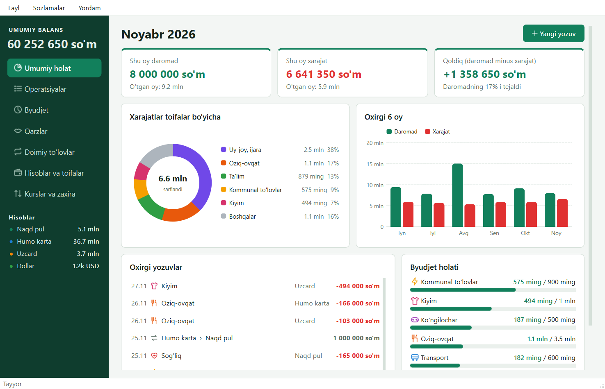
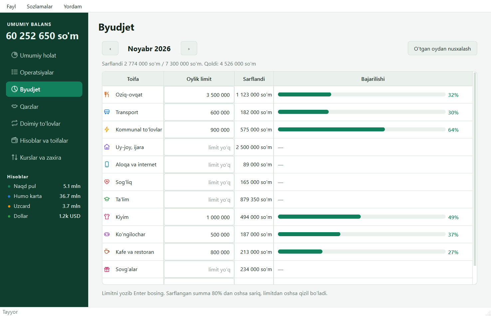

# Xarajatlar hisobchisi: Uslubiy ko‘rsatma

Muallif: Hakimov Bahtiyorjon. Versiya: 1.0.2.

## 1. Uslubiy ko‘rsatmaning maqsadi va vazifalari

Ushbu uslubiy ko‘rsatmaning maqsadi “Xarajatlar hisobchisi” dasturidan moliyaviy savodxonlik, iqtisodiyot asoslari, buxgalteriya hisobi va axborot texnologiyalariga oid fanlarda o‘quv vositasi sifatida foydalanish tartibini belgilashdan iborat. Dastur talabalarga shaxsiy byudjetni yuritish, xarajatlarni toifalash va tahlil qilish, valyuta konvertatsiyasi va qarz majburiyatlarini hisobga olishni real vaziyatga yaqin sharoitda o‘rgatish imkonini beradi.

Uslubiy ko‘rsatmaning vazifalari:

- dasturning imkoniyatlari va o‘quv jarayonidagi o‘rnini aniqlash;
- 80 daqiqalik amaliy mashg‘ulotning namunaviy rejasini taklif etish;
- dasturning haqiqiy funksiyalariga asoslangan amaliy topshiriqlar va kutilgan natijalarni berish;
- baholash mezonlari, nazorat savollari va mustaqil ish uchun tavsiyalarni shakllantirish;
- moliyaviy ma’lumotlar bilan ishlashda xavfsizlik va axborot madaniyati qoidalarini eslatish.
Mashg‘ulot natijasida talaba hisob, toifa, operatsiya, o‘tkazma va byudjet tushunchalarini farqlay oladi; oylik daromad va xarajatni hisoblaydi; byudjet limitlarini belgilab, ularning bajarilishini tahlil qiladi; turli valyutadagi mablag‘larni kurs asosida umumlashtiradi; ma’lumotlarni eksport qilib, elektron jadvalda qo‘shimcha tahlil o‘tkazadi.

Ko‘rsatmada dasturdan moliyaviy maslahat vositasi sifatida emas, balki hisob yuritish va tahlil ko‘nikmalarini shakllantiruvchi o‘quv vositasi sifatida foydalanish nazarda tutiladi.

Ko‘rsatma o‘qituvchiga mashg‘ulotni tayyorlash vaqtini qisqartirish, topshiriqlarni bosqichma-bosqich tashkil etish va talabalar faoliyatini yagona mezonlar asosida baholashda yordam beradi. Topshiriqlar guruhning tayyorgarlik darajasiga qarab qisqartirilishi yoki kengaytirilishi mumkin.

## 2. Qo‘llash sohasi va maqsadli auditoriya

Dasturdan quyidagi fanlar va mutaxassisliklarda foydalanish tavsiya etiladi:

- “Moliyaviy savodxonlik”, “Iqtisodiyot nazariyasi”, “Shaxsiy moliyani boshqarish” fanlari;
- “Buxgalteriya hisobi asoslari” fanida hisoblar, operatsiyalar va qoldiqlar tushunchalarini tushuntirishda;
- “Axborot texnologiyalari”, “Ma’lumotlar bazasi” fanlarida pul summalarini dasturiy ifodalash, relyatsion model va eksport formatlarini o‘rganishda;
- kollej va texnikumlarda iqtisodiyot, bank ishi va buxgalteriya yo‘nalishidagi kasbiy fanlar;
- tashkilotlarda xodimlar uchun moliyaviy savodxonlik bo‘yicha seminar va treninglar.
Maqsadli auditoriya: oliy ta’lim muassasalari, kollej va texnikumlar o‘qituvchilari va talabalari, shuningdek moliyaviy savodxonlik bo‘yicha trenerlar. Dastur bilan ishlash uchun kompyuterdan boshlang‘ich foydalanish ko‘nikmalari yetarli.

Kasbiy faoliyatda dastur tashkilotlarning moliyaviy savodxonlik bo‘yicha o‘quv dasturlarida, yoshlar bilan ishlash markazlarida va ijtimoiy loyihalarda shaxsiy byudjetni yuritishni amaliy ko‘rsatish vositasi sifatida qo‘llanilishi mumkin. Dastur korxonaning buxgalteriya hisobini yuritish uchun mo‘ljallanmagan va rasmiy hisobot vositasi emas.

Mashg‘ulotni foiz, ulush va valyuta kursi tushunchalari o‘rganilgandan keyin o‘tkazish maqsadga muvofiq. Elektron jadvallar bilan boshlang‘ich tanishlik 8-topshiriqni bajarishda yordam beradi.

## 3. O‘quv mashg‘ulotida foydalanish tartibi

Quyida “Shaxsiy byudjetni raqamli vosita yordamida yuritish” mavzusidagi 80 daqiqalik amaliy mashg‘ulot rejasi keltirilgan. Mashg‘ulotdan oldin o‘qituvchi kompyuterlarga dasturni joylashtiradi va har bir talabaga bir oylik shartli daromad va xarajatlar ro‘yxatini (talaba yoki yosh oila misolida) tarqatadi. Mashg‘ulotda faqat shartli ma’lumotlar ishlatiladi.

1. Tashkiliy qism (5 daqiqa): davomatni tekshirish, mashg‘ulot maqsadi va kutilgan natijalarni e’lon qilish.
2. Nazariy qism (20 daqiqa): shaxsiy byudjet tushunchasi; hisob, toifa, operatsiya va o‘tkazma; nima uchun o‘tkazma daromad yoki xarajat hisoblanmaydi; byudjet limiti va uning bajarilishi; valyuta kursi va konvertatsiya; qarz va uning qisman qaytarilishi; doimiy to‘lovlar. O‘qituvchi dastur oynasini proyektorda namoyish qiladi.
3. Amaliy qism (45 daqiqa): talabalar 1–5-topshiriqlarni bajaradi. Har bir topshiriqdan keyin “Umumiy holat” sahifasidagi ko‘rsatkichlar o‘qituvchi tomonidan oldindan hisoblangan qiymatlar bilan solishtiriladi.
4. Yakuniy qism (10 daqiqa): natijalarni muhokama qilish, qaysi toifada xarajat eng ko‘p ekanini va uni kamaytirish yo‘llarini tahlil qilish, uyga vazifa berish.
Nazariy qismda bitta misolni batafsil ko‘rib chiqish tavsiya etiladi: kartadan naqd pul yechish o‘tkazma ekanligi, u umumiy balansni o‘zgartirmasligi, lekin ikki hisob qoldig‘ini o‘zgartirishi. Shuningdek, summalarni butun tiyinlarda saqlash nima uchun yaxlitlash xatolaridan himoya qilishini oddiy misolda tushuntirish mumkin.

Amaliy qismda talabalar individual ishlaydi. O‘qituvchi oldindan hisoblab qo‘ygan kutilgan qiymatlar (oy daromadi, xarajati, toifalar bo‘yicha yig‘indilar) natijalarni tez tekshirishga yordam beradi.

Yakuniy qismda muhokama uchun quyidagi savollar taklif etiladi: qaysi xarajatlar majburiy va qaysilari ixtiyoriy; byudjet limitlarini qanday asosda belgilash mumkin; doimiy to‘lovlarni oldindan rejalashtirish nimaga yordam beradi; moliyaviy ma’lumotlarni internetsiz, mahalliy saqlashning afzallik va kamchiliklari nimada. Muhokama natijalari mustaqil ish mavzusini tanlashda hisobga olinadi.

Mashg‘ulotga tayyorgarlik ko‘rishda o‘qituvchi dasturni oldindan sinab ko‘rishi, shartli ma’lumotlar ro‘yxatini tuzishi va kutilgan ko‘rsatkichlarni hisoblab qo‘yishi tavsiya etiladi. Agar kompyuter sinfida dastur oldin ishlatilgan bo‘lsa, har bir talaba toza bazadan boshlashi uchun avvalgi ma’lumotlarni zaxiralab, dastur papkasini tozalash kerak.

Mashg‘ulotda ulgurilmagan 6–8-topshiriqlar uy vazifasi sifatida beriladi va keyingi mashg‘ulot boshida tekshiriladi.

*1-rasm. Mashg‘ulotda namoyish qilinadigan “Umumiy holat” sahifasi: oylik ko‘rsatkichlar, toifalar diagrammasi va byudjet holati*

*2-rasm. Byudjet limitlarini belgilash va bajarilishini tahlil qilish sahifasi*

## 4. Amaliy topshiriqlar

1. **Hisoblarni sozlash.** Naqd pul, Humo karta va dollar hisoblarini shartli boshlang‘ich qoldiqlar bilan yarating, dollar kursini kiriting. Kutilgan natija: yon paneldagi “UMUMIY BALANS” qo‘lda hisoblangan yig‘indiga mos keladi.
2. **Oylik operatsiyalarni kiritish.** Tarqatilgan ro‘yxat bo‘yicha kamida 15 ta daromad va xarajat yozuvini kiriting, Ctrl+Enter orqali ketma-ket kiritishdan foydalaning. Kutilgan natija: “Shu oy daromad” va “Shu oy xarajat” kartalari kutilgan qiymatlarga teng.
3. **O‘tkazmalar.** Kartadan naqd pulga va so‘mdan dollar hisobiga o‘tkazma qiling. Kutilgan natija: umumiy daromad va xarajat o‘zgarmaydi, hisoblar qoldig‘i esa to‘g‘ri o‘zgaradi; talaba buni izohlaydi.
4. **Byudjet tuzish.** Beshta xarajat toifasiga oylik limit belgilang, ulardan biri oshib ketadigan qilib yozuv qo‘shing. Kutilgan natija: bajarilish chiziqlari yashil, sariq va qizil holatlarda ko‘rinadi.
5. **Tahlil.** “Umumiy holat” sahifasidagi halqasimon diagramma asosida eng katta uchta xarajat toifasini aniqlang va qoldiq kartasidagi tejash foizini yozing. Kutilgan natija: qisqa yozma tahlil.
6. **Qarzlar.** Bitta “Qarz berdim” va bitta “Qarz oldim” yozuvini yarating, ulardan biriga ikki marta qisman qaytarish kiriting. Kutilgan natija: “Qoldiq” ustuni va yuqoridagi kartalar to‘g‘ri hisoblangan.
7. **Doimiy to‘lov.** Har oy takrorlanadigan ijara to‘lovini yarating va keyingi sanani tekshiring. Kutilgan natija: jadvalda to‘lov davriyligi va keyingi sana ko‘rinadi; talaba oy oxiriga to‘g‘ri kelgan sana qanday suriladi, tushuntiradi.
8. **Eksport va zaxira.** Joriy oy operatsiyalarini Excel ga eksport qiling, elektron jadvalda toifalar bo‘yicha yig‘indini hisoblang va dastur natijasi bilan solishtiring; so‘ng zaxira nusxa oling. Kutilgan natija: xlsx fayl, solishtirish xulosasi va zaxira fayli.
Topshiriqlar bajarilgach, talaba qisqa hisobot tayyorlaydi. Hisobotda kiritilgan ma’lumotlar, har bir topshiriqdan keyingi asosiy ko‘rsatkichlar (umumiy balans, oy daromadi va xarajati, byudjet bajarilishi), qo‘lda bajarilgan hisob-kitoblar va ularning dastur natijalari bilan solishtirilishi, aniqlangan farqlar va ularning sabablari yoziladi. 1–5-topshiriqlar mashg‘ulot vaqtida, 6–8-topshiriqlar mashg‘ulot oxirida yoki uy vazifasi sifatida bajariladi.

Tayyorgarligi yuqori guruhlarda o‘qituvchi qo‘shimcha topshiriq berishi mumkin: dollar kursini o‘zgartirib, umumiy balans va o‘tgan oylar grafigi qanday o‘zgarishini kuzatish va bu holatni dastur barcha valyuta operatsiyalarini eng so‘nggi kurs bilan baholashi orqali tushuntirish.

## 5. Baholash mezonlari

Amaliy ish 100 ball bilan baholanadi:

- hisoblar, kurs va operatsiyalarning to‘liq va to‘g‘ri kiritilishi – 25 ball;
- o‘tkazmalar va valyuta konvertatsiyasini to‘g‘ri bajarish va izohlash – 15 ball;
- byudjet tuzish va uning bajarilishini tahlil qilish – 20 ball;
- qarzlar va doimiy to‘lovlar bilan ishlash – 15 ball;
- eksport, elektron jadvalda tekshirish va zaxira nusxa – 10 ball;
- nazorat savollariga javob va muhokamadagi ishtirok – 15 ball.
Baholash shkalasi: 86–100 ball “a’lo”, 71–85 ball “yaxshi”, 55–70 ball “qoniqarli”, 55 balldan kam “qoniqarsiz”. Baholashda natijaning to‘g‘riligi bilan bir qatorda talabaning hisob-kitob mantig‘ini tushuntira olishi ham hisobga olinadi.

Hisob-kitoblarda xatoga yo‘l qo‘yilgan, lekin talaba uning sababini to‘g‘ri aniqlab, tuzatgan holatda ball qisman saqlanadi. Topshiriqlar natijalari (hisobot, xlsx fayl, zaxira fayli) elektron ko‘rinishda, talaba familiyasi yozilgan papkada topshiriladi.

Kechikib topshirilgan ishlar uchun ball kamaytirish tartibi o‘qituvchi tomonidan oldindan e’lon qilinadi. Guruh ishida har bir talabaning hissasi alohida baholanadi.

## 6. Nazorat savollari

1. Hisob, toifa va operatsiya tushunchalarining farqi nimada?
2. Nima uchun hisoblar orasidagi o‘tkazma daromad yoki xarajat hisoblanmaydi?
3. Hisob balansi qanday hisoblanadi?
4. Dasturda valyuta kursi qanday kiritiladi va hisob-kitoblarda qaysi kurs qo‘llanadi?
5. Nima uchun pul summalari butun tiyin yoki sentlarda saqlanadi?
6. Byudjet chizig‘i qachon sariq va qachon qizil rangga kiradi?
7. Qarz qachon avtomatik yopiladi?
8. Doimiy to‘lovlar dastur ochilganda qanday qo‘shiladi?
9. Zaxiradan tiklashda dastur ma’lumotlarni qanday himoya qiladi?
10. Yozuvlari bor hisob yoki toifani o‘chirishda dastur qanday harakat qiladi?
Nazorat savollari og‘zaki so‘rov, yozma test yoki mustaqil ish himoyasida qo‘llanilishi mumkin. 2, 3, 5 va 9-savollarga javob berishda talaba amaliy topshiriqlarda olgan natijalaridan misol keltirishi va dastur interfeysidagi nomlarni to‘g‘ri atashi tavsiya etiladi.

## 7. Mustaqil ish uchun tavsiyalar

- Bir oy davomida o‘z xarajatlaringizni (yoki shartli ma’lumotlarni) dasturda yuriting va oy oxirida toifalar bo‘yicha tahliliy hisobot tayyorlang.
- Oylik byudjet rejasini tuzing va oy oxirida reja bilan haqiqiy natijani solishtiring, farqlar sabablarini yozing.
- Excel eksport fayli asosida elektron jadvalda haftalar bo‘yicha xarajatlar grafigini tuzing.
- Python hujjatlaridagi decimal moduli tavsifini o‘rganib, pul hisob-kitoblarida suzuvchi nuqtali sonlardan foydalanishning xavfi haqida qisqa referat yozing.
- Dastur ma’lumotlar modeliga mos ER-diagramma chizing va o‘tkazmalar qanday ifodalanganini tushuntiring.
- Turli manbalardagi (bank, Markaziy bank) valyuta kurslarini bir hafta davomida kuzatib, ularning farqi dollar hisobining so‘mdagi qiymatiga qanday ta’sir qilishini dasturda hisoblab ko‘rsating.
Mustaqil ish natijalari keyingi mashg‘ulotda qisqa taqdimot shaklida himoya qilinadi.

Himoya jarayonida talaba o‘z tahlilining asosiy xulosalarini va ulardan amaliy foydalanish yo‘llarini qisqa bayon qiladi.

## 8. Xavfsizlik va axborot madaniyati qoidalari

Moliyaviy ma’lumotlar bilan ishlash alohida mas’uliyat talab qiladi. Mashg‘ulotda talabalarga quyidagi qoidalarni tushuntirish va ularga rioya etilishini nazorat qilish tavsiya etiladi:

- O‘quv mashg‘ulotlarida faqat shartli moliyaviy ma’lumotlardan foydalaning; o‘zingizning yoki boshqalarning haqiqiy hisob raqamlari, karta raqamlari va parollarini dasturga yoki izohlarga yozmang.
- Dastur karta raqami, PIN-kod yoki bank paroli talab qilmaydi; agar biror dastur yoki sayt bunday ma’lumot so‘rasa, ehtiyot bo‘ling.
- Shaxsiy moliyaviy ma’lumotlar saqlangan baza faylini begona shaxslarga bermang, zaxira nusxani xavfsiz joyda saqlang.
- Umumiy kompyuterlarda ishlaganda mashg‘ulot oxirida o‘z ma’lumotlaringizni o‘chiring yoki zaxira nusxasini olib, dastur papkasini tozalang.
- Dasturni faqat muallifning rasmiy GitHub sahifasidan yuklab oling.
- Uzoq vaqt kompyuterda ishlaganda har 45–50 daqiqada qisqa tanaffus qiling.
